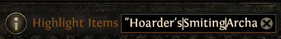
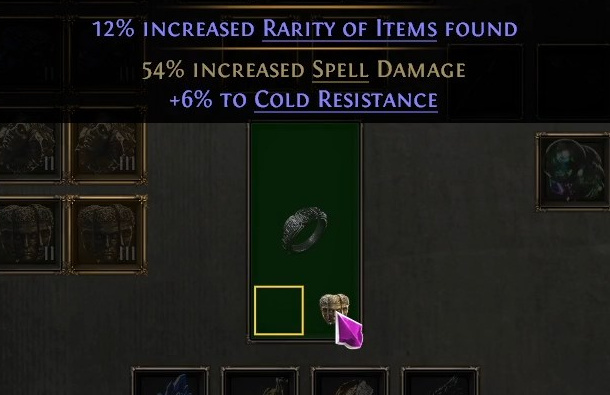
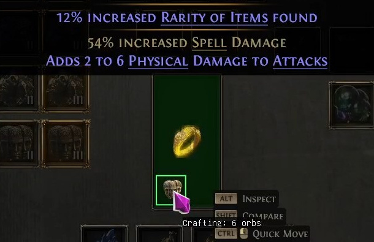
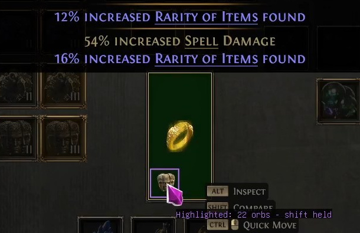

# CraftUntilHighlighted

An ExileApi plugin for Path of Exile 1: a lightweight crafter that applies a currency to an item until the stash search highlights it. A port of the Path of Exile 2 plugin [CraftUntilHighlighted](https://github.com/bnc-anonymous/CraftUntilHighlighted).

## Install

Install using **PluginUpdater**:

1. Add > paste this plugin's URL: `https://github.com/bnc-anonymous/CraftUntilHighlighted1` > Clone
2. Add > paste ExileInput's URL: `https://github.com/bnc-anonymous/ExileInput` > Clone

## Usage

1. Put an item in your currency tab's crafting slot.
2. Type a regex for the modifiers you want into the stash search.

   

3. Right-click the currency you want to use. It must be on the **Allowed currencies** list in the plugin's settings (Chaos Orb, Orb of Alteration, the quality currencies, the catalysts, Jeweller's Orb, Orb of Fusing and Chromatic Orb by default).
4. Move the cursor into the square at the bottom-left of the item.

The plugin will use the currency with a randomised delay until the item is highlighted. You can then click again yourself to roll past a match. Move the cursor out of the square to stop. Moving the mouse within the square, or holding Alt to check the item's modifiers, does not stop the plugin.

Note: the below images are from PoE2, this is a PoE1 port with identical UI.

**Ready**

**Crafting**

**Highlighted**

## Augment boxes

While an Orb of Alteration is selected and a search is typed in the stash search, two boxes show to the right of the item: **Augment on empty prefix** above **Augment on empty suffix**. Move the cursor into a box to switch it on (bright) or off (dim); it switches again only after you move out and back in. Both start off each session.

With a box on, whenever the item is a magic item with that slot empty and not highlighted, the plugin holds Alt to turn the Orb of Alteration into an Orb of Augmentation, waits to see it on the cursor, applies it, and lets go of Alt. Then it carries on with alterations. The boxes can be turned off with **Enable augment boxes** in the plugin's Crafting settings.

## Finding modifier names

The stash search can match a modifier's name. Two useful sites:

- **poedb.tw** lists every modifier an item class can roll, with the name of each tier. Open the item class, for example Rings: https://poedb.tw/us/Rings, find the modifier you want and use the name of the tier you are after.
- **https://poe.re/items** builds a stash search regex for the modifiers you pick.

## License

MIT
